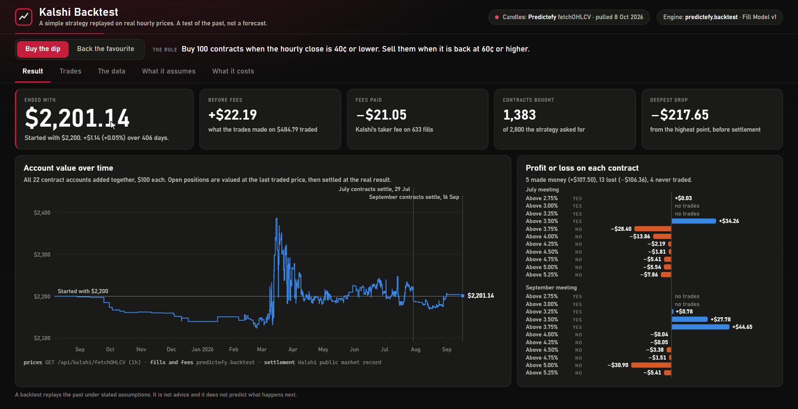

# Kalshi Backtest on Real Hourly Prices

A small, honest backtest for Kalshi. It pulls real hourly price history through the [Predictefy API](https://predictefy.com/en/api?utm_source=youtube&utm_medium=video&utm_campaign=kalshi-backtest&utm_content=github), replays a simple strategy over it with the backtester that ships in Predictefy's Python package, settles what is left at the real result, and shows everything on a local results page: the account value over time, every order, the fees, and where the data is thin.

It runs on your own computer. It never places an order and never asks for a Kalshi login.



> A backtest replays the past under stated assumptions. It is not advice and it does not predict what happens next.

## What it does

1. Lists the contracts in two settled Kalshi events: the Fed's rate after its July and September 2026 meetings, 11 rate levels each, 22 contracts.
2. Pulls every hourly candle for each contract (`fetchOHLCV`, one call per contract) and saves them to disk.
3. Reads the labels on every candle (`source`, `sourceType`, `quality`, `isTrueCandle`), drops candles that cannot be traded against, and counts what it dropped.
4. Replays two strategies with `predictefy.backtest`, one candle at a time, with Kalshi's fees and Fill Model v1.
5. Settles anything still held at the real result: $1 a contract for Yes, $0 for No.

## Quick start

You need [Python](https://www.python.org) 3.10 or newer and a Predictefy API key from [portal.predictefy.com/keys](https://portal.predictefy.com/keys).

```bash
git clone https://github.com/Ong-pogs/kalshi-backtest-predictefy
cd kalshi-backtest-predictefy
python -m venv .venv
source .venv/bin/activate      # Windows PowerShell: .venv\Scripts\Activate.ps1
pip install -r requirements.txt
cp .env.example .env           # Windows PowerShell: Copy-Item .env.example .env
```

Open `.env`, paste your key after `PREDICTEFY_API_KEY=`, then run three commands:

```bash
python fetch.py       # pull the candles (112 credits)
python backtest.py    # replay both strategies from disk (0 credits)
python serve.py       # open the results page
```

Open the address it prints, `http://127.0.0.1:8816`.

The only dependency is the `predictefy` package, pinned to `1.0.0b9` because it is a beta line.

## Which plan you need

| Plan | Price | History it reads | What happens here |
|---|---|---|---|
| Free | $0 | 7 days | These contracts settled more than 7 days ago, so `fetch.py` is refused with `403 PLAN_REQUIRED` and prints the upgrade link. `python fetch.py --free` works. |
| Builder | $48.88 a month | 12 months | `python fetch.py` works as it is. |
| Pro | $149 a month | unlimited | `python fetch.py --all` also reads the few candles older than 12 months. |

Plans and prices: [predictefy.com/en/pricing](https://predictefy.com/en/pricing). The free plan includes 25,000 credits a month, so credits are not the limit here. The history window is.

To try the whole pipeline on the free plan:

```bash
python fetch.py --free                                   # last 7 days of the open October contracts (56 credits)
python backtest.py --data data-free --out results-free
python serve.py --results results-free
```

Those contracts have not settled, so positions are valued at the last traded price and the page says so.

## What this costs to run

| Request | Calls | Credits each | Credits |
|---|---|---|---|
| List the contracts in an event (`GET /api/kalshi/fetchMarkets`) | 2 | 1 | 2 |
| Hourly candles for one contract (`GET /api/kalshi/fetchOHLCV`) | 22 | 5 | 110 |
| **The whole backtest** | 24 | | **112** |
| Run the strategies again from the saved candles | 0 | | 0 |

`fetch.py` counts the `x-credits-charged` header on every response and writes the total to `data/manifest.json`. `python peek.py` prints one raw candle for 5 credits.

## The strategies

| Name | Rule |
|---|---|
| Buy the dip | Buy 100 contracts when the hourly close is 40¢ or lower. Sell them when it is back at 60¢ or higher. |
| Back the favourite | Buy 100 contracts when the hourly close is 85¢ or higher, and hold them until the market settles. |

Both are in [`kalshi_backtest/strategies.py`](kalshi_backtest/strategies.py), about 25 lines each. A strategy sees one candle at a time, after that hour has closed, and an order it places can fill no earlier than the next candle. Each contract gets its own $100 account, so every contract's result stands alone.

## What the result rests on

`predictefy.backtest` prints its assumptions with every report, and the results page shows them in full. The main ones:

- **No queue position.** A resting order fills only when the price trades through it, never on a touch.
- **No price improvement.** A resting order gets its own limit price, never a better one.
- **No market impact.** An order may take at most a quarter of what a candle traded.
- **No latency.** There is no delay between deciding and arriving, but nothing fills before the next candle.
- **Fees.** Kalshi's published taker fee, `0.07 x contracts x price x (1 - price)`, on every fill, rounded up.

Added by this project: settlement at the real result (the engine stops at the last candle), and a loader that drops candles with no volume, a zero price, a `suspect` label or a book-derived price.

## What it cannot tell you

- **It is a small sample.** 22 contracts are two Fed decisions seen from 11 rate levels each. They move together.
- **It only buys the Yes side.**
- **Hourly candles are sparse.** A candle exists only for an hour in which the contract traded. Far-dated contracts go weeks without one, and an order cannot fill in an hour nobody traded.
- **An account value in the middle of the run is not cash.** Open positions are valued at the last traded price, which in a thin market can be a few contracts at an odd price.
- **Settlement results come from Kalshi's public market record**, not from Predictefy: the market stops trading before the Fed announces, so the last candle does not show the outcome.
- **It is the past.** A flat or good result says nothing certain about the next year.

## Build it yourself

[`build-prompt.txt`](build-prompt.txt) is the full specification: the endpoints, the candle checks, the two rules, the settlement step and the results page. Paste it into an AI coding tool in an empty folder.

## Tests

```bash
python -m unittest
```

## License

MIT. See [LICENSE](LICENSE).
